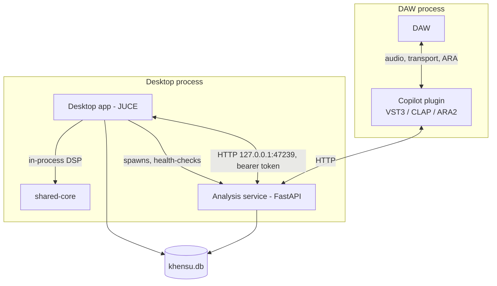

<p align="center"></p>

# Khensu Mixing & Mastering Suite

<!-- Stack -->


<!-- Size -->


<!-- Verification (local runs of scripts/verify_all.ps1) -->


<!-- Evidence (resources/calibration/finding_evidence.json) -->


<!-- Project -->


**🎚️ An explainable mixing and mastering assistant that runs on your own machine.**

Khensu listens to a mix or a master and tells you what is wrong, why it matters and how to fix it. It then renders the fix and lets you compare it with the original at matched loudness, so "better" never just means "louder". It is a native C++ / JUCE desktop app and a DAW plugin, backed by a local Python analysis engine.

🔒 **Local-first.** All audio processing happens on your computer. The few online features (song identification, a cloud chat model, model downloads, update checks) can each be switched off in Settings, and one master switch turns them all off.

> 🚀 **v1.0.4, Windows first.** Download it from the public [releases page](https://github.com/KhensuLabs/khensu-mixing/releases/latest). macOS has an installer build (`packaging/macos/`, `release-macos.yml`) that becomes a verified release in v1.1.
>
> **How this is verified.** Every number in the badges comes from local runs of `scripts/verify_all.ps1`. It builds everything and runs the three Catch2 suites, the full pytest suite with the analyzer golden gate, pluginval in fixed and random order, a Debug run with its debug output captured, an installer smoke test (silent install, version and secret checks, uninstall) and the doc-drift, lint and string-template gates. Last full pass: 2026-11-22, for v1.0.2. An 8-hour soak (786 analyse / fix / delete cycles) kept memory, handles and GUI objects flat.

---

## At a glance

- 🔍 **Finds and explains** what's wrong: every finding reads Detected → Cause → Fix → Trade-off → Verify, with its measurement.
- 🛠️ **Fixes in one click**, stacking renders through pre- and post-render safety gates.
- ✅ **Proves the fix worked**: re-analysis marks each finding resolved, improved, unchanged, worse or new.
- 📊 **Checked against released music**: each finding shows how often it fires on released tracks, how often it catches the defect it names and how often its fix clears it. Each one warns on about 5% of released tracks or fewer.
- 🎧 **Honest A/B** at matched loudness, with Delta and Blind modes.
- 🌍 **185 genres** with targets measured from released music.
- 💿 **Masters and delivers**: platform masters, streaming preview, compliance, DDP, album masters.
- 🎛️ **In your DAW**: the Khensu Copilot plugin (VST3 / CLAP / ARA2).
- 🔄 **Updates itself**: downloads a new release in the background and installs it on restart.

| 🎯 Made for | What Khensu gives them |
|---|---|
| 🎹 Producers and bedroom artists | *why* the mix sounds smaller than the references, and a fix for it |
| 🎚️ Mix engineers | a measured second opinion, a stackable fix queue, before/after proof |
| 💿 Mastering engineers | safe platform targets, real codec previews, a complete delivery package |
| 🎓 Students | explanations tied to measurements of their own tracks |
| 📀 Artists finishing a record | consistent loudness and tone across tracks, and the album master |

## Contents

- ✨ [What it does](#what-it-does)
- 📐 [How it decides](#how-it-decides)
- 🌍 [Genres](#genres)
- 🧠 [Machine learning, and where it isn't used](#machine-learning-and-where-it-isnt-used)
- 🏗️ [Architecture](#architecture)
- ⬇️ [Install](#install)
- ▶️ [Use it](#use-it)
- 🧪 [Test it](#test-it)
- 🗂️ [Repository layout](#repository-layout)
- 🗺️ [Roadmap](#roadmap)
- ⚖️ [License](#license)

---

## What it does

### 🔁 The core loop

1. **Load a track** (Intake, `Ctrl+O`). Drop a file and Khensu shows what it detected - genre, key, tempo - with one **Confirm genre**, or change the target yourself (185 genres). Then **Create Session**. Pipeline options sit under Advanced.
2. **Read the analysis** (Analysis). The loudness, true peak and clipping readings show within seconds, marked provisional; findings and grades appear as soon as everything a grade is built from has finished, and the remaining scans fill in their panels after. Related views share one card with tabs - Stereo & mono, Tone, Loudness & delivery, Provenance & source, Stems - instead of a wall of separate cards. Each finding follows **Detected → Cause → Fix → Trade-off → Verify**, and one click opens the full "why this?" trace, written in plain words.
3. **Work the issue queue** (**Issues**, or `F` for the top one). Every finding is in one list with **Fix**, **Mark done**, **Dismiss** (with a reason Khensu learns from) and **Why?**. A fix renders through the safety gates from the *current* version, so fixes stack, and becomes the B side.
4. **See whether it worked.** After every fix Khensu re-analyses the new version and marks each finding resolved, improved, unchanged, worse or new, with the measured deltas. **Hear what changed** loops each region the fix altered, and a fix that only improved a finding offers **Stronger** or **Gentler**.
5. **Compare honestly** (`B`, `Space`, or **Hear A/B** in the queue). A/B is loudness-matched by turning the louder side down, with Delta and Blind modes. "Start from: original" in the transport begins a fresh branch.
6. **Deliver** (Export, `Ctrl+E`). Export exactly what you're hearing, make platform masters, run the compliance sheet, build a delivery package.

### 🔍 Analysis and explanation

- **Loudness, dynamics, tone, stereo, artifacts.** LUFS / LRA / true peak, crest and compression behaviour, spectral balance and tilt, stereo width and mono compatibility, clipping and codec artifacts.
- **Music.** Key with a calibrated confidence (key profiles chosen by genre), time signature (4/4, 3/4, 6/8) with the downbeat, beat-synchronous chords with Roman numerals and a real "no chord", Camelot codes, **song structure** (intro, verse, pre-chorus, chorus, bridge, outro and their repeats, found from the audio's self-similarity), hooks, memorability, heaviness, arrangement, and pitch accuracy against the track's own tuning.
- **Where, not just how much.** Per-window timelines show where loudness, harshness and dynamics go wrong; **Explain this moment** measures any selected region against the whole track and the genre norm.
- **Perceptual loudness.** Partial loudness (Moore–Glasberg) turns "the vocal is buried" into a number.
- **Fixes for what used to be advice.** Spectral tilt renders a 1 kHz shelf solved from the track's spectrum, a resonance renders a notch, a raised noise floor renders a spectral denoiser (it clears 95% of injected hiss) and DC offset renders a 20 Hz high-pass. Clipping stays advice, because the app has no way to check a declipper's result.
- **Evidence you can export.** Every recommendation carries its measurement, threshold, source and confidence basis, as JSON or a client-readable HTML page. A **counterfactual** gives the smallest change that would clear a finding ("−2.1 dB at 250 Hz"), checked by re-measuring a render.
- **References.** Keep a library of your own reference tracks - tag them and give each a genre, then filter by either - find the ones nearest your mix or search them by description ("warm, wide, slow"), and make one the session's reference - the comparison updates at once. Fit a readable EQ and compressor chain toward a reference or toward your genre, with an amount control and the predicted per-band result before anything renders.
- **Where you sit in your genre.** The Genre Fit card shows, for loudness, crest, brightness, tilt, low end and width, where your mix falls among released tracks of the genre - measured, with the number of tracks behind it.
- **Trust.** Every measurement carries a value, a confidence and a quality flag. A clipped signal marks its loudness reading unreliable, and recommendations built on shaky numbers are down-weighted and say so.

### 📈 Seeing it

- **Against released tracks, not one target line.** The tonal-balance chart draws where released tracks of the genre sit - their middle 50 % and 80 %, measured with the app's own analyzer - and colours your curve where it leaves them (red: more energy, blue: less). Every measurement tile has a strip of dots, one per released track, with "Louder than 92 % of released Glitch Hop"; the readiness categories sit against the same spread.
- **A detailed spectrogram.** The whole song in 256 log bands from a 4096-point FFT, with a smooth low end (a 60 Hz tone peaks at 60 Hz, not on an FFT bin), a perceptual colour map shared by every spectrogram, the sections across the top and each finding's frequency range at the edge. Beside it, the spectrum at the cursor or playhead against the song's average. Hover for time, frequency, musical note and level; scroll to zoom, drag to pan, click to play from there; the playhead follows playback.
- **Where in the song.** One time axis for the sections, waveform, short-term and momentary loudness (true-peak overs marked where they happen), the spectrogram and every finding that happens at a moment, with **Play this moment**. Click to seek, scroll to zoom.
- **What a fix changed, measured.** The difference spectrum and the difference in loudness over time against the original, a small difference sparkline on every version in the render tree, and an A/B toggle that glides the spectrum between the two.
- **Output meters that never sit blank.** Stopped, they show the analysed integrated loudness, true peak, correlation and a looped slice of the song in the vectorscope; playing, the live signal.
- **Live.** A GPU-composited scrolling spectrogram of what is playing with the findings' frequency bands across it, stereo width per octave beside the vectorscope, and each module of the signal chain drawn - EQ curves, the compressor's transfer curve and gain reduction, the limiter's reduction history - in the app and in the plugin.
- **Stems and albums.** Each stem's energy over time as a streamgraph, a frequency x time masking map for any pair, and an album chart of every track's loudness and tonal balance.
- **One chart toolkit and palette**: every chart reads out the exact value under the pointer; colours are colour-blind checked and severity keeps its own. A shareable **visual report** puts the key charts in one HTML page, and a built-in demo song fills the screens on first run.

### 💿 Mastering and delivery

- **Master Assistant** (Export > Finish): mastering on one card from the session's own target. The mastering agent works on the current version toward the session's genre and its master goes into the loudness-matched A/B; five macros (loudness, tone, width, punch, ceiling) re-render it; Accept makes it the current version and shows the check against the original's findings; then the platform masters.
- **Platform masters** (Spotify, Apple Music, YouTube, club and more), true-peak-safe and checked by the post-render guardrail.
- **Streaming preview.** A real codec round trip (Opus, AAC, MP3 through `ffmpeg`), then each platform's normalisation and limiter, then a playback-device profile, all A/B-able at matched loudness.
- **Compliance sheet** for true peak, mono compatibility, DC offset, clipping, bit depth, metadata and broadcast specs (EBU R128, ATSC A/85, podcast).
- **Delivery package**: master WAV, DDP, stems, instrumental, optional clean version, a hashed manifest and C2PA content credentials when you supply a certificate.
- **Immersive check** for 5.1, 7.1 and 7.1.4 and ADM BWF: multichannel loudness, per-channel true peak, stereo fold-down and binaural previews.
- **Projects and albums**: a project is one session per track in album order (a multi-file drop makes one). Export > Album shows it as a readiness board - every track's loudness, true peak, readiness and which master the album uses - beside a cross-track consistency matrix, normalisation simulation and an album master plan (DDP, cue, WAV) built from those masters.
- **Atomic exports** of the current render, with unique file names so the render history never points at an overwritten file.

### 🎤 Vocals, assistant and forensics

- **Vocal workspace**: stem separation (Demucs, or RoFormer when installed; a multitrack session's own tracks fill the stems instead), one session Takes bin shared by comping, take alignment and preflight, edits that stack on one current vocal, vocal macros with live audition, gain riding, de-essing, comping and take alignment, pitch editing with snap-to-key (a learned pitch tracker, CREPE, refined by YIN), harmony MIDI and lyric intelligibility.
- **Stem rebalance**: turn each stem up or down - or let Khensu suggest it from the genre's stem balance - and render the re-summed mix as a new version. It sums the edited vocal, so it is how vocal edits are committed to the mix.
- **Copilot**: a chat assistant, a mixer-chain generator, a mastering agent, and an **agentic mixing loop** that renders a step, re-measures it at matched loudness, and keeps or reverts it, with every step in the render tree. It understands typed or spoken instructions ("make the chorus 1 dB louder than the verse"): 95% of spoken commands parse the same as typed ones (94% with room noise). Every part works offline; a language model is optional. A local 7B model (Ollama) returns valid structured output in about 0.8 s.
- **Personal ranking**: learns from the renders you keep, revert and dismiss, and reorders recommendations with the reason shown.
- **AI-generation detection**: metadata and byte signatures, spectral and codec-residual tells, per-stem tells, and optional learned and watermark detectors, fused with a per-window timeline. Provenance evidence is kept apart from production-style evidence.
- **Analog Feel**: a creative render (tape drift, a slow fader ride, room tone) with an amount control. **Metadata clean** removes workflow and personal tags and keeps identity, rights and AI-disclosure tags.

### 🤝 Collaboration and versions

- A **branching render tree** with tags and named restore points; any two versions can be diffed per metric, including which notes were fixed or introduced.
- **Comments pinned to a time or range**, `.khensu` session bundles for sharing, and a **revision report** ("what changed, what got fixed").
- An opt-in **LAN listening room** for blind, loudness-matched votes from another device.

### 🎛️ In your DAW

The **Copilot plugin** builds as **VST3**, **CLAP** and an **ARA2** VST3 (AU on macOS):
- live meters and the current recommendations for the desktop session you choose, graded against that session's genre from the measurements the desktop stored (no second analysis), with an RMS-matched A/B and a Blind mode;
- a **Hosted** tab that runs your own VST3 effects in the copilot's chain, latency-compensated;
- a **Mix** hub across every Copilot instance in the session ("Kick vs Bass at 58 Hz");
- an issue timeline that seeks the host, and fixes written back as plugin automation (or exported as MIDI CC / REAPER envelopes);
- with ARA, analysis reads the audio straight from the host; no bounce needed;
- **Capture...**: record the next 4, 8 or 16 bars, or the loop region, and the desktop app opens it as a new session with the followed session's target - no bounce and drop;
- one plugin-chain model: the plugin's DSP tab (and the desktop's Signal Flow Rack) edit it, and the mixer-chain generators and onboarding hand it a chain to apply rather than pushing their own.

### 🧰 Around the edges

- **MCP server** (`khensu-mcp`) so Claude or another MCP client can analyse, explain, fit chains and run the agent.
- **Headless CLI** (`khensu analyze`) for folders and catalogues, with CI-friendly exit codes.
- **GPU acceleration** through ONNX Runtime (DirectML / CUDA / CoreML) and torch when available.
- **Long and hi-res files**: stereo songs up to about 25 minutes, and 192 kHz or 7.1 songs up to about 5.8 minutes, within a fixed memory budget.
- **Analysis cache**: a content-addressed cache makes reopening a session instant, and after a render only the changed regions are re-measured.
- **Local crash reports**: minidumps and Python fault logs stay on your machine; Settings exports a diagnostics bundle (including where the engine's memory is).
- **Components**: Settings lists every optional component and installs the pip-installable ones from their reviewed, hash-pinned package lists.

---

## How it decides

Khensu never says "this sounds bad". Every verdict traces back to a named measurement with a documented formula, compared against a genre-relative target.

| Signal | How it's measured | What it drives |
|---|---|---|
| **Loudness (LUFS-I, LRA)** | ITU-R BS.1770-4 with exact K-weighting, gated integration (−70 LUFS absolute, −10 LU relative). Mono is measured as one channel. LRA per EBU Tech 3342 (P95 − P10 of ungated 3 s short-term loudness after its gates). | Genre loudness targets; platform ceilings |
| **True peak** | 4× polyphase FIR oversampling (257-tap Kaiser-windowed sinc), zero-padded, so the file's end can't wrap into its start. | The limiter ceiling and the post-render guardrail |
| **Crest factor** | `20·log10(peak / RMS)` per channel; the largest is reported; channels below −90 dBFS RMS are ignored. | Over-compression detection |
| **Tone** | Spectral centroid, and tilt as the dB-per-octave slope of octave-band energy up to 20 kHz (sample-rate independent). | "Too dark / too bright"; the match-EQ curve |
| **Stereo** | Mean-removed Pearson correlation; width = `clamp(2S²/(M²+S²), 0, 1)`, identical in C++ and Python; mono compatibility from summed-mono band loss. | Phase-risk widening blocks; the mono-bass guardrail |
| **Key, meter, harmony** | Krumhansl–Kessler or Temperley key profiles (by genre) with a best-vs-runner-up confidence; meter from accent periodicity and bar-level self-similarity; beat-synchronous chord templates with smoothing; tuning from the circular mean of pitch cents. | Note spelling, Camelot hints, harmony timeline, pitch accuracy |
| **Song structure** | Bar-synchronous chroma and MFCC self-similarity; Foote novelty peaks for boundaries; repetition groups; roles from repeats and level. | Section loudness arc, chorus contrast, section mastering, "the chorus" in commands |
| **Masking** | Per-critical-band energy overlap between separated stems. | Causal evidence links ("the 250 Hz mud is caused by the bass / vocal overlap") |
| **Mood and energy** | Russell's circumplex from brightness, energy and tempo. | Emotional arc; creative-target fit |
| **Genre position** | Your value's rank inside the genre's reference distribution. | "78th percentile for loudness in this genre" |

- **Severity** uses a fixed full scale per metric (12 dB LUFS, 10 LU LRA, 6 dB crest, 4 dB/octave tilt, 0.5 width), so being 1 dB over a −11 LUFS ceiling is as severe as 1 dB over a −23 LUFS one.
- **Thresholds are measured.** A finding counts as an alarm when it reaches moderate severity or worse. Each threshold is set so the finding alarms on about 5% of released tracks or fewer while still catching the defect it names, which is injected into those same tracks. Song-level notes (hooks, memorability, heaviness, section arc) stay minor notes on about 15% of tracks or fewer until a listener study checks them. Delivery-spec checks such as true peak over −1 dBTP are reported as "released tracks that miss the spec" rather than as false alarms: 82% of released masters miss it.
- **Evidence fusion** for AI detection is noisy-OR, `P = 1 − Π(1 − pᵢ)`, so one strong tell counts and scattered weak ones don't overclaim.
- **Learned probabilities** are shown as numbers only when the model is both intervention-validated and well calibrated (low expected calibration error); otherwise you see a qualitative band.
- **Renders are gated twice**: a pre-render validator fails closed on unsupported layouts or risky widening, and a post-render guardrail re-measures at matched loudness and blocks a change that adds clipping, collapses mono bass or crushes dynamics.

The whole rule-based tier lives in the C++ `shared-core/`, which has no ML dependencies by design.

---

## Genres

Each of the 185 genres has its own target profile in `resources/genre_norms/genre_targets.json` (loudness and LRA ranges, true-peak ceiling, tone, low-end weight, width, compression, heaviness and hook norms, notated tempo range, vocal presence). For the 113 genres with enough tracks in the on-disk corpus, the tone, tilt, crest, low-end and width targets are **measured** from released music by the app's own analyzer (`genre_corpus_stats.json`); loudness stays hand-set. Genre-relative recommendations run only after you confirm the genre; until then Khensu says it is abstaining and why. Each finding also says how often it fired on released tracks of their own genre, how often it alarmed (moderate or worse), how reliably it catches the defect it names, and how often the app's own Fix cleared that defect (`resources/calibration/finding_evidence.json`, measured by `scripts/measure_genre_norms.py`). The evidence covers 1,462 released tracks through the native pass and 209 lossless ones through the app's full pipeline, including the deep-pass findings (harshness, resonance, mid/side brightness, translation risk and the song-level notes). Defects are injected into those tracks: EQ bells, resonances, comb filtering, wide sub, bright sides, limiting, downward expansion, gain and side-gain changes, and bass-heavy or thin tonal balance. Those measurements set the LRA windows and the thresholds, grade a master that is quieter than its genre but at or above -16 LUFS as a minor note, and sized the tonal fixes: a fix's EQ is solved from your track's own spectrum, and the tonal fixes clear 75-80% of the defects they target.

<details>
<summary><strong>All 185 genres, by family</strong></summary>

**Electronic (55)** Acid House, Afro House, Amapiano, Ambient, Ambient Dub, Breakcore, Breaks, Brostep, Chillstep, Chillwave, Dark Ambient, Darksynth, Deconstructed Club, Deep House, Digital Hardcore, Drone, Drum & Bass, Dubstep, Dungeon Synth, EBM, Electro House, Electro Swing, Experimental Noise, Footwork, Future Bass, Future Garage, Gabber, Garage, Glitch Hop, Gqom, Hard Techno, Hardstyle, Hardvapour, House, Industrial, Industrial Techno, Jungle, Liquid Drum & Bass, Lo-Fi Beats, Mallsoft, Melodic Dubstep, Minimal Techno, Neurofunk, Nightcore, Progressive House, Retrowave, Riddim, Speedcore, Synthwave, Tech House, Techno, Trance, UK Garage, Vaporwave, Witch House

**Hip-Hop (34)** Boom Bap, Brooklyn Drill, Cloud Rap, Digicore, Drill, Emo Rap, Grime, Jerk, Jersey Club, Latin Trap, Lo-Fi Hip-Hop, Melodic Rap, Phonk, Plugg, Rage, Rap, Sigilkore, Trap, UK Drill, Conscious Rap, Gangsta Rap, G-Funk, Crunk, Hyphy, Jazz Rap, Horrorcore, Trap Metal, Abstract Hip-Hop, Southern Hip-Hop, West Coast Hip-Hop, East Coast Hip-Hop, Miami Bass, Afro-Trap, PluggnB

**Pop (32)** Art Pop, Avant-Garde Pop, Bedroom Pop, Bubblegum Pop, Chillpop, City Pop, Dance Pop, Dariacore, Dream Pop, Electropop, Hyperpop, Indie Pop, J-Pop, K-Pop, Pop, Synthpop, Teen Pop, Alt-Pop, Power Pop, Baroque Pop, Dark Pop, Sophisti-Pop, Jangle Pop, Pop Rock, Country Pop, Latin Pop, Afro-Pop, Pop Soul, Glitch Pop, Chamber Pop, Bubblegum Bass, Adult Contemporary

**Rock (25)** Alt-Rock, Emo Rock, Grunge, Hardcore Punk, Indie Rock, Math Rock, Midwest Emo, Noise Rock, Pop Punk, Post-Hardcore, Post-Rock, Punk, Rock, Sadcore, Screamo, Slowcore, Stoner Rock, Art Rock, Britpop, Garage Rock, Psychedelic Rock, Post-Punk, Gothic Rock, Surf Rock, Progressive Rock

**R&B (15)** Alt R&B, Funk, Gospel R&B, Neo Soul, R&B, Soul, Trap Soul, Contemporary R&B, Quiet Storm, Disco, Motown, New Jack Swing, Bedroom R&B, Psychedelic Soul, Afro R&B

**Metal (9)** Black Metal, Death Metal, Deathcore, Djent, Doom Metal, Mathcore, Metal, Metalcore, Nu Metal

**World (5)** Afrobeats, Baile Funk, Corridos Tumbados, Dembow, Reggaeton

**Jazz (2)** Free Jazz, Jazz · **Folk (2)** Acoustic, Singer-Songwriter · **Reggae (2)** Dancehall, Reggae · **Alt-Rock (1)** Shoegaze · **Blues (1)** Blues · **Cinematic (1)** Cinematic · **Country (1)** Country

</details>

---

## Machine learning, and where it isn't used

Three tiers, and the UI always says which one produced a number:

1. **Rule-based DSP (the default).** Most of the 79 analyzer modules and the whole C++ recommendation engine: real measurements with documented formulas and no training data.
2. **Trained models (opt-in), only where DSP can't do the job.** Each ships with a model card (held-out accuracy, calibration, per-source breakdown) and an explicit `intervention_validated` flag, and stays off until enabled.
3. **Language models (optional).** Local servers (llama.cpp, Ollama, LM Studio) are detected and preferred; Anthropic, Google, OpenAI-compatible, DeepSeek and Moonshot work with your own key. Every feature that can use one has a deterministic offline path.

| Model | Task | Status |
|---|---|---|
| `ai_detector.onnx` | AI-generated vs human music | 98.4% validation accuracy, ECE 0.018; not intervention-validated; opt-in |
| `ai_attribution.onnx` | Which generator (Suno, Udio, MusicGen, ...) | opt-in |
| `artifact_model.onnx` | Multi-label forensic artifacts | 0.828 validation accuracy, ECE 0.042; opt-in |
| `mix_quality.onnx` | Self-supervised mix-defect detector | opt-in |
| `leak_gate.onnx` | Per-band stem-bleed classifier | opt-in |
| `mood_tagger.json` | Mood and theme tags beside the rule-based estimate | opt-in |
| AudioSeal / WavMark | Watermark presence | third-party; 0 / 300 false positives on real music; opt-in |
| Demucs `htdemucs`, RoFormer | Stem separation | after the reviewed `stems` profile / the `[roformer]` extra |
| basic-pitch (ONNX) | Polyphonic transcription | the separate Python 3.11 profile; falls back to the vocal tracker |
| CREPE-tiny (`vocal_pitch.onnx`) | Monophonic vocal pitch | exported by `scripts/export_crepe_onnx.py` (MIT weights); `pyin` without it |
| Beat This! (`beat_tracker.onnx`) | Beats and downbeats for song structure | `scripts/export_beat_this_onnx.py`; the librosa tracker without it |
| CLAP | Audio embeddings and text search; the nearest reference shares the genre family 59% of the time (chance is 23%) | `[ai_detect]`; a built-in embedding otherwise |
| `clap_ai_probe.json` | AI-generation likelihood on CLAP embeddings, shown beside the verdict | trained on seven generators; AUC 0.92-0.98 on a generator it never saw, 3.8% of lossless human releases called AI; not intervention-validated |

Calibrated per-finding confidence (CE-TRU-1) is built but needs a labelled corpus; until then every finding says "heuristic". See [`docs/ml-models.md`](docs/ml-models.md).

---

## Architecture

Four components talk over one authenticated localhost HTTP service, and share one SQLite store, `khensu.db` (WAL mode, one numbered migration chain in `storage/schema/`).



| Component | Path | Role |
|---|---|---|
| **Shared core** | `shared-core/` | C++17 library: native meters, analyzers, the rule-based recommendation engine, genre targets, and the service client. The client is generated from the service's OpenAPI schema, so renaming a field is a compile error, not a panel that silently shows 0. |
| **Desktop app** | `desktop-app/` | 11 screens and 90+ panels. A thin `AppController` hub over eight services (playback, renders, stems, vocal edits, analysis, sessions, service lifecycle, cloud chat); panels depend on the narrowest interface. Background work runs on owned pools and is tagged with a session epoch, so a late result never lands in the wrong session. |
| **Copilot plugin** | `plugin-copilot/` | Meters, recommendations, honest A/B, hosted VST3 chain and the multi-instance Mix hub inside the DAW. |
| **Analysis service** | `local-services/` | 79 analyzer modules behind 38 routers (the plain file analyses are one table). Every route has a typed request and response model; long work runs as jobs on bounded executors; shared modules own loudness, stereo, note names and harmony so every screen reports the same number. |

**Service lifecycle.** The app starts the service (`local-services/launch_service.py`) and checks it every couple of seconds with an HMAC-proved `/health` that also carries the `SERVICE_VERSION` handshake, so a stale build on the port is replaced. While it starts or is down, one banner says so and offers a restart. You never start it by hand.

More: [`docs/architecture.md`](docs/architecture.md), [`docs/frontend.md`](docs/frontend.md), [`docs/backend.md`](docs/backend.md).

---

## Install

### ⬇️ Download

Installers are published on the
[releases page](https://github.com/KhensuLabs/khensu-mixing/releases/latest),
which the app's update check reads.

| | Installer | Installs |
|---|---|---|
| 🪟 Windows 10 / 11 | `khensu-setup-<version>.exe` (`packaging/khensu-installer.iss`) | the app and its Python engine; the VST3 / ARA and CLAP plugins |
| 🍎 macOS 11+ | `khensu-setup-<version>-macos.pkg` (`packaging/macos/build_and_package.sh`; built by `release-macos.yml`, unverified until v1.1) | the app to Applications; the VST3 to `Library/Audio/Plug-Ins/VST3`, the AU to `.../Components` |

- 📁 **Choose the folders.** The Windows installer has a page for the app's
  folder and one for the VST3 and CLAP folders (defaults: the standard folders
  DAWs scan). It installs per user without administrator rights, or for
  everyone when run elevated. The macOS `.pkg` installs for the current user
  (`~/Applications`, `~/Library/Audio/Plug-Ins`) or for all users, each part
  optional; its `.dmg` holds the bundles to drag anywhere.
- 🔄 **Updates.** The app checks the releases page when it opens (at most
  hourly) and on demand (Settings > Privacy & online > **Check now**, or
  "Check for updates" in the command palette, Ctrl+K). A newer release's
  installer for the OS is downloaded in the background, kept only if it matches
  the SHA-256 GitHub publishes for it, and installed silently into the same
  folders when Khensu closes - **Restart now** does it at once and reopens the
  new version. Settings can turn the download off; a copy built from source
  never updates itself.
- 🔐 **What ships.** The installer packages only an allow-listed stage of the
  service (`scripts/stage_local_services.py`), and
  `scripts/scan_release_secrets.py` refuses keys, tokens, settings, databases
  or the builder's email and home path in anything that ships.
- ⚠️ The installers are not code-signed yet, so Windows SmartScreen may warn on
  first run ("More info" > "Run anyway") and macOS Gatekeeper may need
  right-click > Open.

### 🔨 Build from source

#### Requirements

| | Windows | macOS (experimental) |
|---|---|---|
| CMake | 3.24+ | 3.24+ |
| Compiler | Visual Studio 2022 (Build Tools are enough) | Xcode 14+ command-line tools |
| Python | 3.11+ | 3.11+ |
| OS | Windows 10 / 11 | macOS 12+ |

The first configure fetches JUCE, SQLiteCpp, Catch2, the ARA SDK and the CLAP extensions through CMake.

#### Windows

```powershell
git clone https://github.com/KhensuLabs/khensu-mixing.git
cd khensu-mixing

# Build the app and the plugins (Release). Keep parallelism at 2-4: more can exhaust compiler memory (C1060).
cmake -B build -G "Visual Studio 17 2022" -A x64
cmake --build build --config Release --parallel 3

# The analysis service's environment, inside local-services/ so the app finds it.
cd local-services
python -m venv .venv
.venv\Scripts\python -m pip install -e .
cd ..

"build\desktop-app\KhensuDesktop_artefacts\Release\Khensu Mixing.exe"
```

The build is warning-clean under `/W4 /WX`. Built artifacts:
- `build/desktop-app/KhensuDesktop_artefacts/Release/Khensu Mixing.exe`
- `build/plugin-copilot/KhensuCopilot_artefacts/Release/VST3/Khensu Copilot.vst3` (plus the `.clap` and the ARA2 `.vst3`)

#### macOS (Intel and Apple Silicon)

The service needs Python 3.11-3.13 (3.14 has no Intel-Mac numba build; the
lock pins Intel Macs to numba 0.62 / llvmlite 0.45 -
`scripts/check_platform_wheels.py --platform macos-x86_64` checks every
runtime package has a wheel). `packaging/macos/build_and_package.sh` builds,
bundles and signs (ad hoc without a Developer ID) the app and plug-ins.

```bash
cmake -B build -G Xcode && cmake --build build --config Release
cd local-services && python3.13 -m venv .venv && .venv/bin/python -m pip install --require-hashes -r requirements-hashed.txt && .venv/bin/python -m pip install --no-deps -e . && cd ..
open "build/desktop-app/KhensuDesktop_artefacts/Release/Khensu Mixing.app"
```

### 🧩 Optional components

Each is large; install only what you need. **Settings > Models & components** lists them all, shows which are installed and installs the pip-installable ones for you (the same hash-locked files, with online downloads allowed); the commands below do the same by hand. Hash-locked requirement files keep installs reproducible.

| Component | Install |
|---|---|
| Lyric transcription, voice commands | `pip install --require-hashes -r requirements-asr-hashed.txt`, then `pip install -e . --no-deps` |
| Cloud copilot SDK, ONNX models, AI-detection extras | the same pattern with `requirements-copilot-hashed.txt`, `requirements-onnx-hashed.txt`, `requirements-ai-detect-hashed.txt` |
| Stem separation (Demucs, torch 2.13) | `packaging\install-optional-stack.ps1 -Stack stems -PythonExe .venv\Scripts\python.exe` |
| Polyphonic MIDI (basic-pitch) | a separate Python 3.11 environment, below |
| Vocal pitch model (CREPE-tiny) | `python scripts/export_crepe_onnx.py` (needs the `torchcrepe` wheel once, for its weights) |
| Beat / downbeat model (Beat This!) | `python scripts/export_beat_this_onnx.py --checkpoint small0.ckpt` (with `beat_this` importable) |

**Polyphonic MIDI** runs basic-pitch's ONNX model in its own Python 3.11 environment, with no TensorFlow. Install it with `--no-deps` (basic-pitch's own metadata would pull TensorFlow back in):

```bash
cd local-services
py -3.11 -m venv .venv311
.venv311/Scripts/python -m pip install --no-deps --require-hashes -r requirements-pitch-hashed.txt
.venv311/Scripts/python -m pip install --no-deps -e .
```

`local-services/.venv311/` is a fixed path the service looks for; without it, MIDI extraction falls back to a monophonic estimate. It looks like a duplicate venv; don't delete it.

**Installer.** `packaging/khensu-installer.iss` (Inno Setup) installs the app and the service. Stage the service with `python scripts/stage_local_services.py --check` and the Python runtime with `packaging/build-python-env.ps1`.

---

## Use it

| Shortcut | Action |
|---|---|
| `Ctrl+O` | Open an audio file |
| `Ctrl+R` | Analyse again |
| `F` | Fix the top issue |
| `B` | Switch A/B (original / fix) |
| `Space` or `Ctrl+Space` | Play / pause |
| `N` | Next unresolved issue |
| `Ctrl+E` / `Ctrl+,` | Export / Settings |
| `Ctrl+1` … `Ctrl+0` | The Nth screen in the sidebar |
| `Ctrl+Z` / `Ctrl+Y` | Undo / redo |
| `Ctrl+K` | Command palette: every screen and action |
| `F1` / `F6` | Keyboard help / move between sidebar, screen and transport |

Bare keys (`F`, `B`, `N`, `Space`) act only when a session is open and no text field has focus.

**The screens**, in sidebar order: Intake, Issues, Analysis, Mix / Master, Vocal, Export (the workflow), then Copilot, Provenance & Source and References (tools), then Help and Settings. Each screen's header names it and says what it is for; on Intake, Issues and Export it also holds the screen's main action. Export is four steps - Finish (the Master Assistant), Export, Delivery and Album. The optional session-health strip (break reminders, ear fatigue) is in the command palette.

### 🖥️ Headless

```bash
cd local-services
.venv/Scripts/khensu analyze mix.wav --report mix.html
.venv/Scripts/khensu analyze bounces/ --recursive --target spotify --report reports/ --json results.json
.venv/Scripts/khensu analyze bounces/ --json - --fail-on severe     # exit 1 on a failing check
.venv/Scripts/khensu targets                                       # ids for --target
```

It runs the same measurements, compliance sheet and report writer as the app, in-process, with no service and no network. The desktop executable forwards the same arguments (`"Khensu Mixing.exe" --analyze ...`).

---

## Test it

```bash
# C++: KhensuCoreTests (shared-core), KhensuTests (desktop logic), KhensuPluginTests (plugin)
cmake --build build --config Release --target KhensuCoreTests KhensuTests KhensuPluginTests --parallel 3
ctest --test-dir build -C Release --output-on-failure

# Python
cd local-services && .venv/Scripts/python -m pytest -q

# Everything hosted CI would run, locally
pwsh scripts/verify_all.ps1          # -Fast for the pre-push subset
```

- **Golden gate.** `local-services/tests/golden/` pins analyzer outputs; a refactor that shifts a number fails. Regenerate only for an intended change (`KHENSU_REGEN_GOLDEN=1`).
- **Doc and code gates.** `scripts/check_doc_drift.py` checks counts, the version handshake, theme-only colours, UTF-8 string safety, generated-client freshness and hidden-control mistakes; `scripts/extract_strings.py --check` keeps the translation template current. Both run in the versioned pre-push hook (`pwsh scripts/install-hooks.ps1`).
- **Seeing the UI without a person.** `"Khensu Mixing.exe" --screenshot=<dir>` writes every screen (add `--screenshot-audio=<wav>` to analyse a file first), `--a11y-audit=<file>` checks every control has a spoken name, `--ui-bench=<file>` fails on a mis-laid-out screen.
- **Evidence on released music.** `scripts/measure_genre_norms.py` runs the app's own analysis over the genre corpus (`measure` / `dynamics` for the native pass, `full` for the full pipeline against the running service, `fixcheck` for the app's fixes) and writes `resources/calibration/finding_evidence.json` with `report`. Re-run it when a finding's threshold or fix changes.
- **Soak and stress.** `"Khensu Mixing.exe" --soak-audio=<folder> --soak-minutes=N` repeats analyse / fix / delete and logs memory and handles; `scripts/stress_long_files.py` drives every route with long, hi-res and surround files.
- **Each pytest run needs its own `--basetemp`** when two run at once; pytest wipes it on start.

---

## Repository layout

```text
shared-core/      C++ library: native DSP, recommendations, generated service client
desktop-app/      JUCE desktop app (Source/ui: one folder per screen, shared widgets in ui/shared)
plugin-copilot/   VST3 / CLAP / ARA2 copilot plugin
local-services/   Python FastAPI analysis and render service, its tests and the CLI
tests/            Catch2 suites: shared-core/, ui/, plugin/
storage/schema/   SQLite migrations 001-016 (one khensu.db)
resources/        Genre norms, finding evidence (calibration/), system-brain data, the OpenAPI schema, the string template
packaging/        Installer, optional-stack installs, macOS scripts, signing
scripts/          verify_all, doc-drift, generators, benchmarks
docs/             Architecture, DSP and math, ML models, and the user manual
```

📖 Documentation: [architecture](docs/architecture.md) · [frontend](docs/frontend.md) · [backend](docs/backend.md) · [DSP and math](docs/dsp-and-math.md) · [ML models](docs/ml-models.md) · [user manual](docs/manual.md).

---

## Roadmap

- **On-hardware checks**: the plugin in real DAWs (hosted VST3s, ARA, CLAP, automation write-back), high-DPI and 120 Hz displays, real MIDI 2.0 devices, screen readers.
- **macOS v1.1**: a verified universal build, AU validation, signing and notarisation.
- **Listener studies** for the song-level notes (hooks, memorability, heaviness, section arc), which stay minor until checked, and hand-marked sections for song structure.
- **Validated models**: a labelled, expert-reviewed corpus to calibrate findings and to clear the `intervention_validated` gate on the learned detectors.
- **Signed installers** so Windows SmartScreen and macOS Gatekeeper don't warn.
- **AI detection without provenance**: the CLAP probe now generalises across seven generators; next is checking it on AI music from sources outside its training sets before it can inform the verdict.

---

## License

Khensu Mixing is free software under the **GNU Affero General Public License, version 3 or later** ([`LICENSE`](LICENSE)): you may use, study, share and modify it, and anything you distribute built from it - or offer to others over a network - must be released under the same license with its source.

It builds on JUCE (used under the AGPL), GPL-licensed pedalboard and mutagen, and many permissively licensed libraries, listed with their licenses in [`THIRD_PARTY_NOTICES.md`](THIRD_PARTY_NOTICES.md). Some optional research models are non-commercial (CC BY-NC) and are never bundled.

The source is public at [KhensuLabs/khensu-mixing](https://github.com/KhensuLabs/khensu-mixing), and each release's installers are on its [releases page](https://github.com/KhensuLabs/khensu-mixing/releases/latest).
