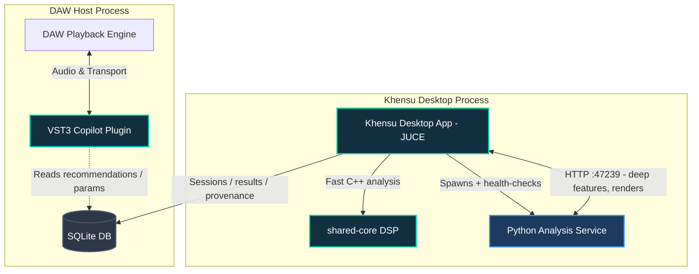

# Architecture

A deeper technical reference than the README's overview. See the
[README](../README.md) for build and test commands; [`frontend.md`](frontend.md)
and [`backend.md`](backend.md) for the desktop/plugin and service layers;
[`dsp-and-math.md`](dsp-and-math.md) for the measurements, formulas and
decision logic; [`ml-models.md`](ml-models.md) for the learned models; and the
[user manual](manual.md) for every feature from the user's side.

## The four components

Khensu is four cooperating components sharing one localhost HTTP service.
Persistence is consolidated into **one** SQLite store, `khensu.db`, shared by
the C++ desktop app and the Python service (WAL mode with `busy_timeout` so
both processes can hold it open). It carries sessions/analysis/preferences/
scanned plugins, recommendation feedback + learned preference weights,
parameter-override telemetry, and the append-only provenance-event timeline —
all under one numbered migration chain in `storage/schema/`. The legacy
per-store files (`feedback.db`, `service_feedback.db`, `provenance_events.db`)
are one-time imported on upgrade (backup-first, then retired to `*.migrated`,
never deleted) — the 2026-07-23 DB unification (ARCH-03). Nothing talks to the network except
the optional, individually-toggleable features named in the README's
Philosophy section.



| Component | Path | Language | Role |
|-----------|------|----------|------|
| **Shared Core** | `shared-core/` | C++17 (JUCE) | Static lib: fast in-process DSP analyzers + rule-based recommendation engine. Shared by the app and the plugin. Zero ML dependencies by design. |
| **Desktop App** | `desktop-app/` | C++17 (JUCE GUI) | The main product — 11 screens, 90+ analysis panels. Owns sessions, playback, render orchestration, and the Python service lifecycle. |
| **VST3 Copilot Plugin** | `plugin-copilot/` | C++17 (JUCE plugin) | Runs inside a DAW; surfaces live meters + current recommendations, a level-matched A/B, and a hosted third-party VST3 chain. Links `KhensuSharedCore`. |
| **Python Analysis Service** | `local-services/` | Python 3.11+ (FastAPI) | Heavy feature extraction + audio rendering. ~79 analyzer modules, 38 routers. |

## Why a split C++/Python architecture

Fast metering (loudness ballistics, meter refresh, live plugin display) needs
to run in-process, synchronously, with no IPC round-trip — that's
`shared-core`. Heavy feature extraction (librosa spectral analysis, Demucs
separation, ONNX inference) needs a mature DSP/ML ecosystem that doesn't exist
in C++ — that's the Python service. The desktop app does its own fast analysis
via `shared-core` in-process, and delegates to the Python service over HTTP for
anything heavier. The plugin *does* talk to the Python service directly too: a
`CopilotTransportController` thread posts playhead state and polls seek/parameter changes
over HTTP roughly every 200ms, and it can invoke deep analysis directly for
its own copilot suggestions — it isn't purely a passive SQLite reader of
whatever the desktop app already wrote. Only the desktop app owns the Python
service's *lifecycle* (start/restart/stale-process detection); a DAW-hosted
plugin with no desktop app running depends on some other process already
having started it (see "Service lifecycle" below).

## Service lifecycle

- The desktop app **auto-launches** the Python service on startup via
  `local-services/launch_service.py` (spawned by `PythonServiceManager.cpp`).
  On first run that script bootstraps a `.venv` and `pip install -e .`
  automatically. You normally never start the service by hand.
- The service listens on **`127.0.0.1:47239`** only — never binds a public
  interface.
- Every request is authenticated with a **per-machine bearer token** written to
  a platform config dir (Windows `%APPDATA%\KhensuMixing\token.txt`; see
  `khensu_services/auth.py`).
- The C++ side talks to it via `shared-core/src/ipc/HttpServiceBridge.cpp`.
- **Health and readiness.** `ServiceLifecycle` probes `/health` (an HMAC proof
  of the token, plus the version) about every 1.6 s with a 2.5 s timeout;
  three misses close the bridge's identity gate and the sidebar shows the
  engine stopped. Analysis does not trust a single probe either: the deep pass
  waits up to 8 s for a busy engine (`analysis/ServiceReadyWait.h`) before it
  falls back to fast results, and logs why. While the engine starts (after
  3 s) or is down, one app-wide notice says so and offers a restart.
- **Start-up cost.** `import khensu_services.server` is ~1.35 s with a 1.5 s
  budget enforced by `tests/test_service_import_budget.py`: ML stacks, scipy's
  signal and stats modules and ReportLab load on first use.
- A `SERVICE_VERSION` handshake over `/health` requires an **exact** match
  between `local-services/khensu_services/version.py` and the C++ side's
  `PythonServiceManager::kExpectedServiceVersion` (not a prefix comparison);
  a mismatch signals a stale service process bound to the port from a previous
  run and it is respawned. **Bump `SERVICE_VERSION` whenever a route or response
  model shape changes** — this is the single most common cause of "Could not
  reach /analyze/…" errors when it's forgotten.
- **Ownership contract (audit ARCH-05):** only the desktop app owns the
  service's *process* lifecycle (spawn, restart-on-crash, stale-process
  detection). The plugin is a best-effort HTTP client only — it never spawns,
  stops, or restarts the service, even when hosted in a DAW with no desktop
  app running. This is a deliberate choice, not an oversight: some DAW hosts
  sandbox or restrict child-process creation from a plugin, so having the
  plugin take on spawn/supervisor responsibility was judged higher-risk than
  the alternative of a DAW-only user needing to separately launch the desktop
  app once to get transport sync and deep analysis. What the plugin *does* do
  is make the resulting dependency legible instead of silent:
  `khensu::ipc::ServiceHealthTracker` (`shared-core/include/khensu/ipc/
  ServiceHealthTracker.h`) turns the raw poll-success bool from
  `CopilotTransportController::run()` into a tri-state status - `NeverConnected`
  (the desktop app hasn't been seen this session; the fix is to start it),
  `Connected`, or `Lost` (it was there and went away mid-session) - surfaced
  in the plugin editor's service-health label
  (`PluginProcessor::serviceHealthStatus()` / `PluginEditor::timerCallback()`).

## Data flow: intake to render

1. **Intake** — the desktop app reads the file, does fast local metering via
   `shared-core`, and kicks off a job-based deep-analysis call to the Python
   service (`startAnalysisJob` → poll `getAnalysisProgress`, not one blocking
   HTTP call — see `frontend.md` for why).
   The channel layout is resolved here and is a hard gate: only Mono, Stereo,
   5.1, and 7.1 are accepted, and an unsupported layout fails before any
   measurement is produced (never a partial-but-confident result). The resolved
   layout travels on `AnalysisResult.channel_layout`; loudness applies BS.1770
   channel weighting (LFE excluded, surround +1.5 dB) and the spectral mono mix
   excludes LFE. Rendering remains mono/stereo — a surround source analyzes
   correctly and is refused for render until the surround render path lands
   (audit AQ-01).
   **Channel order is assumed, not read (CORE-21).** The layout comes from the
   channel count alone: JUCE's reader does not expose a WAV channel mask, so
   a 6-channel file is taken as 5.1 in SMPTE/WAV order (L R C LFE Ls Rs) and an
   8-channel one as 7.1 (L R C LFE Ls Rs Lb Rb). A file in another order (for
   example film order, L C R Ls Rs LFE) is measured with the wrong channel as
   LFE: its loudness excludes the wrong channel and its fold-down is wrong.
   The Python immersive check (`/delivery/immersive_check`) does read the
   `WAVE_FORMAT_EXTENSIBLE` channel mask and ADM metadata, so use it to
   confirm the layout of a surround master (`shared-core/.../ChannelLayout.h`).
2. **Analysis** — the Python service extracts ~76 analyzer modules' worth of
   features (loudness, spectral, stereo, musical/structural, music-theory,
   forensic) and returns them. Every Python loudness/true-peak/LRA/crest
   number comes from one shared module (`analysis/loudness.py`) and every
   width/correlation/tilt number from another (`analysis/dsp_metrics.py`),
   using the same definitions as the C++ analyzers — so the desktop meter,
   the deep analysis, and the compliance sheet report the same value for the
   same file. `shared-core`'s rule-based recommendation engine turns
   measurements into genre-aware, explainable recommendations
   (Detected → Cause → Fix → Trade-off → Verify). The per-measurement trust
   map (`/analyze/measurement_quality`) rides along on
   `AnalysisResult::measurement_trust`, and the engine down-weights any
   recommendation whose driving measurement is flagged tentative/unreliable —
   severity scaled before the sort, confidence capped, and an abstention note
   set — so a shaky number never ranks as if it were solid.
   Findings and grades show once this main pipeline has finished (the
   results gate, PERF-1); the fast local pass shows at once as provisional
   numbers, and the Dashboard's other scans fill in afterwards. Decoded audio
   and scan results are cached - in memory per process and on disk by the
   file's content hash - so a reopened session reads them back (PERF-2/3,
   `backend.md`). The findings land in one issue queue (CON-1), where each
   is fixed, marked done or dismissed.
3. **Render** — "Fix" builds a `pedalboard` processing chain
   server-side, from the current version by default so fixes stack (WF-1;
   "Start from original" in the transport bar starts a fresh branch). Every render passes through two safety gates before it can
   replace the user's audio:
   - **Pre-render validator** — fails closed on unsupported layouts or
     phase-risky operations before rendering starts.
   - **Post-render guardrail** (`render_guardrails.py`) — re-measures the
     result at matched loudness against the source and blocks a render that
     added clipping, collapsed mono bass, or crushed dynamics. This applies to
     every render path, including the iterative Mastering Agent loop (see
     `mastering_agent.py` — every iteration is guardrail-checked, and the
     agent proposes a best-safe candidate rather than silently promoting one).
4. **Version tree** — renders aren't overwritten; they form a branching render
   tree so any two versions can be diffed (What Changed) or A/B'd, loudness-matched.
   Every desktop render gets a unique timestamped filename
   (`ui/shared/RenderPaths.h`), so undoing to an older node really plays that
   node's audio; export writes a temp file and atomically swaps it in, and
   exports the *current* render (with its measured loudness), not always the
   original. A render's node is a child of the version it processed.
5. **Check** — every accepted version is re-analysed and compared with the
   original's findings: resolved, improved, unchanged, worse or new, with the
   metric deltas (FEAT-1, `desktop-app/Source/analysis/FixVerification.h`).
   The issue queue shows the outcome per finding.

## Concurrency model

**Python service.** Blocking work never runs on Uvicorn's event loop. Three
bounded pools live in `khensu_services/common/executors.py` (imported by the
routers directly; `server.py` only re-exports them): `dsp_executor` (4 workers,
`run_blocking`) for analysis/render DSP, `separation_executor` (1 worker) for
Demucs/HPSS, and `llm_executor` (4 workers, `run_llm_blocking`) for LLM
provider calls, so a slow model can't starve analysis. Long jobs follow the
start/poll/cancel pattern via the shared helpers in `common/jobs.py`
(admission caps → 429, dedup keyed on a fingerprint of every output-affecting
request parameter). Status codes follow one convention (`common/errors.py`) —
see [`backend.md`](backend.md).

**Desktop app.** `AppController` is split by concern across
`AppController.cpp` (core, UI wiring, timer), `AppController_Session.cpp`
(session lifecycle, `resetSessionScopedState()`, a latest-wins single-writer
autosave), `AppController_Render.cpp` (render history/undo/tree, renders,
export, reports, separation) and `AppController_Playback.cpp` (transport, A/B,
solo, gain), with the pure state machines `session/ServiceHealthMonitor.h` and
`session/PlaybackSourceController.h` unit-tested on their own. Background work
runs on two **owned** pools — `runInBackground` (8 workers) and
`runLongInBackground` (6 workers, for polls and streams) — both drained at
shutdown. Each job is tagged with the **session epoch**; a result whose epoch
is no longer current is dropped instead of being published into the next
session (see [`frontend.md`](frontend.md)). Playback decodes through a
`TimeSliceThread` read-ahead (64k samples) so disk I/O never runs on the audio
callback.

**Plugin.** Editor-side background work runs on a processor-owned pool, so it
can't outlive the plugin DLL; the audio thread only ever sees immutable
snapshots of the hosted chain.

## The three-tier ML philosophy

See `ml-models.md` for the full model inventory. The short version, enforced
architecturally:

1. **Rule-based DSP is the default** (the large majority of the 76 analyzer
   modules) — named, documented formulas, no training data. This is the entire
   `shared-core/` C++ engine and most of the Python analyzers.
2. **Trained models are opt-in**, used only where DSP genuinely can't do the
   job (stem separation, pitch transcription, AI-generated-audio detection,
   mood/theme tagging beyond the rule-based heuristic). Every trained model
   ships with a model card and an `intervention_validated` flag that gates
   whether its output is shown as a confident verdict or as evidence only.
3. **LLM is fully optional.** Every LLM-touching feature (chat, chain
   generation, the mastering agent's critique step, recommendation
   explanations) has a deterministic offline fallback that runs with no API
   key and no network call.

## Directory layout

```text
shared-core/          # C++ static lib: DSP + recommendations
  include/khensu/      # Public headers, namespaced by domain (analysis/, recommendations/, …)
  src/                 # Implementations mirroring include/ layout
desktop-app/Source/   # JUCE app; ui/ holds one dir per screen + ui/shared/ widgets
plugin-copilot/Source/ # VST3 plugin
local-services/
  khensu_services/     # analysis/ (analyzers + routers), recommendations/, report/,
                       #   copilot/ (LLM agent), feedback/, events/, common/, util/
  tests/               # pytest suite + tests/golden/ (DSP-regression fingerprint)
  launch_service.py    # entry point the desktop app spawns
  pyproject.toml       # deps + optional extras (pitch/asr/copilot/onnx/ai_detect/dev)
cmake/                 # FetchJUCE / FetchSQLiteCpp / FetchCatch2 / CompilerFlags
tests/                 # C++ Catch2 tests: shared-core/ (KhensuCoreTests), ui/ (KhensuTests),
                       #   plugin/ (KhensuPluginTests)
storage/schema/        # Numbered SQLite migrations (001_… 016_…)
resources/             # genre_norms/, system_brain/ JSON data, fonts/, models/ (gitignored)
corpus_data/           # local-only training corpora (gitignored, see corpus_data/README.md)
docs/                  # this file + frontend.md/backend.md/ml-models.md, plus
                       #   architecture, DSP and math, ML models, the user manual
```

## Build system

- **C++**: CMake ≥ 3.24, C++17. First configure fetches JUCE, SQLiteCpp, and
  Catch2 via `FetchContent`. MSVC builds with `/W4 /WX` (warnings-as-errors),
  `/permissive-`, and `/utf-8` — a new warning fails the build, and `/WX` is
  never disabled to work around one.
- **Python**: the service's own `.venv` inside `local-services/`, installed
  editable (`pip install -e .`). Optional heavy extras (`.[pitch]`,
  `.[asr]`, `.[copilot]`, `.[ai_detect]`, `.[onnx]`, `.[dev]`) are split
  deliberately so installing one doesn't force-install another's conflicting
  pins. Demucs itself is not a pyproject extra: it installs through
  the reviewed, hash-pinned `packaging/install-optional-stack.ps1 -Stack stems`
  profile, and the pitch profile lives in its own Python 3.11 venv
  (`.venv311`): basic-pitch on its ONNX model with no TensorFlow, installed
  `--no-deps` from `requirements-pitch-hashed.txt`.
- **Parallelism**: cap C++ builds at `--parallel 3`-`4`; unbounded parallel
  builds have run the machine out of memory (MSVC `C1060`, Win32 `1455`).

## Testing gates

C++ (Catch2), Python (pytest), the DSP golden-regression fingerprint, and CI
are run as the README's "Test it" section describes - the short version:
every change should leave all three Catch2 targets (`KhensuCoreTests`,
`KhensuTests`, `KhensuPluginTests`) and the pytest suite green, and the golden fingerprint should only move when a change
*intentionally* alters analyzer output.
